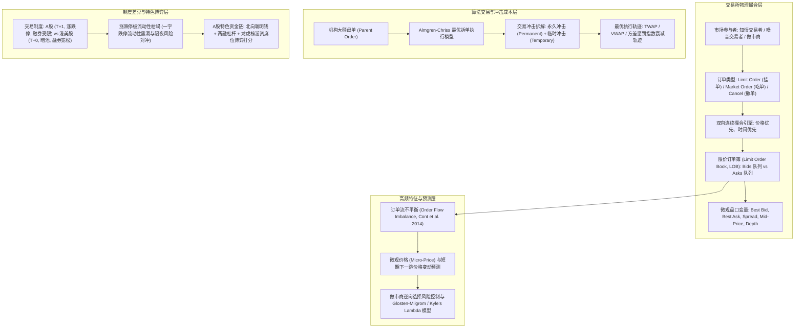

# 模块 02：市场微观结构与订单簿动力学 (02_micro_market)

> **"Price is an illusion formed by the discrete collisions of passive queues and aggressive sweeps."**  
> 价格并非连续平滑的布朗运动，而是无数限价挂单队列与侵略性吃单市价流在纳秒级订单簿上的离散物理碰撞。

---

## 一、模块全景导读与第一性原理

在量化高频交易（HFT）、算法交易执行（Algo Execution）以及做市商（Market Making）的世界中，宏观经济只是一片遥远的大陆，而**市场微观结构（Market Microstructure）**才是每毫秒决定财富转移的微观物理粒子系统。

绝大多数散户只看到分钟或日线 K 线图，然而：
1. **K 线是信息被严重降采样（Downsampled）后的模糊投影**：一根阳线既可能是做市商温和垫单被动成交，也可能是机构利用冰山算法跨越三档深度暴力扫盘（Aggressive Sweep）；
2. **买卖价差（Bid-Ask Spread）与深度（Depth）是流动性的真实价格**：做市商通过在买一和卖一之间双边挂单赚取半价差（Half-Spread），同时承担被拥有私有信息的知情交易者“逆向选择”（Adverse Selection）击穿盘口的库存风险；
3. **订单流不平衡（Order Flow Imbalance, OFI）是价格跳跃的根本动能**：价格之所以向上变动，不是因为“买的人多”，而是买方限价单增量与市价吃单量系统性压倒了卖方挂单撤单速率，迫使卖方最优盘口（Best Ask）被彻底清空；
4. **交易规则是套利与风控的绝对硬边界**：A 股的 T+1 制度与 10%/20% 涨跌停板机制，在极端行情下会导致买/卖盘物理断流，形成“流动性锁死与黑洞”；而港美股的 T+0、做市商制度、暗池（Dark Pools）与内部化（Internalization）则形成了截然不同的流动性博弈生态。

---

## 二、知识图谱与微观结构动力学流向图

---

## 三、课程目录与学习路径

| 课程编号 | 课程主题 | 核心理论与量化方法 | 对应代码文件 | 对应答案文件 |
| :--- | :--- | :--- | :--- | :--- |
| **Lesson 01** | **限价订单簿撮合机制与盘口深度动力学** | 价格优先/时间优先队列、双向连续撮合、挂单/吃单/撤单、盘口深度与买卖价差计算 | `lesson01_lob_mechanics.py` | `answers/lesson01_lob_mechanics.py` |
| **Lesson 02** | **市场交易制度差异与涨跌停流动性枯竭** | A股 (T+1/涨跌停) vs 港美股 (T+0/暗池/做市商)、跌停流动性锁死判定、隔夜风险对冲 | `lesson02_market_rules_arbitrage.py` | `answers/lesson02_market_rules_arbitrage.py` |
| **Lesson 03** | **订单流不平衡 (OFI) 与高频价格预测** | Cont-Kukanov-Stoikov (2014) 订单流不平衡、Tick级别深度挂单量差分、中间价线性预测 | `lesson03_order_flow_imbalance.py` | `answers/lesson03_order_flow_imbalance.py` |
| **Lesson 04** | **交易冲击成本与 Almgren-Chriss 最优拆单** | Kyle's Lambda 价格冲击、Almgren-Chriss 方差惩罚拉格朗日求解、TWAP/VWAP 轨迹 | `lesson04_market_impact_slippage.py` | `answers/lesson04_market_impact_slippage.py` |
| **Lesson 05** | **资金流向透视与龙虎榜游资席位博弈** | 北向资金拆解、两融杠杆买入占比、龙虎榜知名游资与机构专用席位多维博弈打分器 | `lesson05_capital_flow_seat_tracker.py` | `answers/lesson05_capital_flow_seat_tracker.py` |

---

## 四、工业界量化工程标准与通关准则

本模块严格参照顶尖高频量化机构（Jane Street, Citadel Securities, Jump Trading, 国内头部量化幻方/九坤/明汯）的微观生产标准：
1. **纯净高效的微观模型设计**：
   - 彻底拆解交易所撮合状态演进，从底层队列理解滑点成因，拒绝脱离物理撮合的纸上谈兵；
   - 杜绝使用未安装外部重型依赖，完全基于 Python / NumPy / Pandas 高效实现。
2. **严格防范时序与因果前视偏差**：
   - 高频微观数据中，每一笔成交必须发生在其委托提交之后；
   - OFI 计算严格遵循上一快照到当前快照的增量状态，严禁引入任何未来盘口。
3. **完成与考核标准**：
   - 每课提供**练习版本**（含 `# TODO` 填空与丰富测试断言）与 **`answers/` 参考答案版本**。
   - 所有答案代码必须通过 Python 运行并 100% 通过全部 `assert`（`exit code 0`）。
   - 每课包含 3 道深度机制思考题（Q1, Q2, Q3），考核标准：代码 4 分 + 思考题各 2 分，满分 10 分，8 分达标通过。一票否决：撮合顺序倒置、将撤单误记为成交、删除断言校验。
