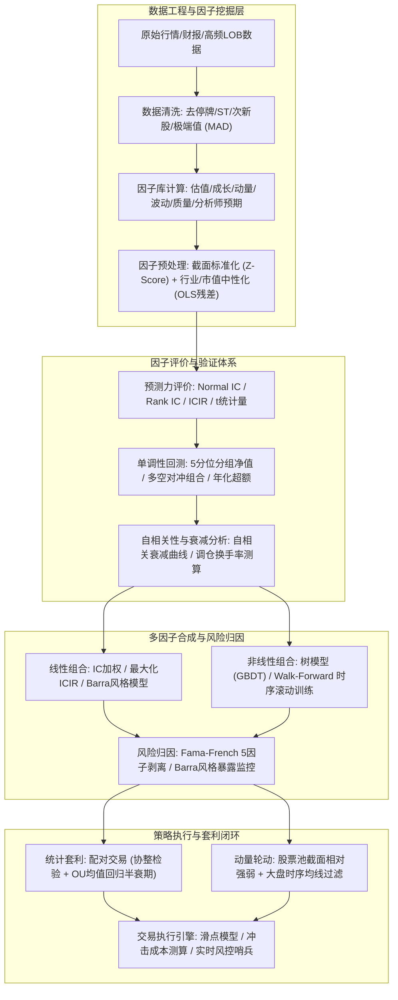

# 模块 05：量化投资、多因子模型与统计套利 (05_quant_trading)

> **"If you can't measure it, you can't manage it; if you can't quantify your edge, you are merely donating liquidity to the market."**  
> —— 主动管理基本定律（Fundamental Law of Active Management）：$IR \approx IC \times \sqrt{BR}$。超额收益不仅来自于预测的精准度（$IC$），更来自于独立决策的广度（$BR$）与严密的风险敞口剥离。

---

## 一、模块全景导读与第一性原理

在量化投资与金融工程的严谨体系中，资产定价与策略构建已由传统的“选股故事”演变为高度工程化、数理化的**风险溢价分解**与**统计规律捕获**。本模块围绕现代量化投资的三大支柱展开：

1. **因子投资与套利定价理论（APT / Factor Investing）**：
   - 股票收益率的生成过程可严格拆解为公因子收益率加权与个股特质收益（Idiosyncratic Return）：
     $$R_i - R_f = \alpha_i + \sum_{k=1}^K \beta_{i,k} f_k + \epsilon_i$$
   - 寻找真正的 Alpha，本质上是在剥离掉市场（Beta）、市值（SMB）、估值（HML）、盈利（RMW）、投资（CMA）及行业风格敞口后，验证特质收益期望是否在统计学上显著异于零。

2. **单因子检验的科学实证框架**：
   - 信息系数（Normal IC 与 Spearman Rank IC）量化因子的截面预测能力；
   - 信息比率（ICIR）衡量预测稳定度与信噪比；
   - 分位数单调性（Monotonic Quantile Portfolios）检验收益递增/递减结构，剔除伪因子与非线性陷阱。

3. **统计套利与相对价值（Statistical Arbitrage & Pairs Trading）**：
   - 区别于简单的价格差，利用 Engle-Granger 两步法协整检验与 Ornstein-Uhlenbeck (OU) 连续均值回归随机微分方程，估算价差半衰期（Half-life），构建严密的均值回归统计套利闭环。

4. **非线性因子组合与机器学习前沿**：
   - 摒弃静态线性等权打分，采用梯度提升决策树（LightGBM / XGBoost）挖掘高阶交互特征；
   - 严格采用带隔离窗口（Purged / Embargoed Walk-Forward）的时序交叉验证，从工程源头杜绝前视偏差（Lookahead Bias）。

5. **动量双生子：横截面动量 vs 时间序列动量**：
   - 横截面动量（Cross-Sectional / 相对强弱轮动）寻找行业与个股间的分化赢家；
   - 时间序列动量（Time-Series / 绝对趋势跟踪）提供下行危机 Alpha 与系统性系统性风控过滤。

---

## 二、量化投研流水线与工程知识图谱

---

## 三、课程目录与学习路径

| 课程编号 | 课程主题 | 核心理论与量化方法 | 对应代码文件 | 对应答案文件 |
| :--- | :--- | :--- | :--- | :--- |
| **Lesson 01** | **单因子检验框架与 IC/Rank IC** | 截面去极值与标准化、Normal IC、Spearman Rank IC、ICIR、t-检验、5 分位单调分组收益回测 | `lesson01_single_factor_testing.py` | `answers/lesson01_single_factor_testing.py` |
| **Lesson 02** | **Fama-French 多因子与 Barra 风险归因** | Fama-French 五因子（MKT, SMB, HML, RMW, CMA）、多重时间序列 OLS 回归、特质波动率与风格暴露剥离 | `lesson02_fama_french_barra.py` | `answers/lesson02_fama_french_barra.py` |
| **Lesson 03** | **统计套利与配对交易 (Pairs Trading)** | 时间序列平稳性检验 (ADF)、Engle-Granger 协整检验、Ornstein-Uhlenbeck (OU) 均值回归过程、半衰期估算与动态 Z-Score 套利 | `lesson03_statistical_arbitrage_pairs.py` | `answers/lesson03_statistical_arbitrage_pairs.py` |
| **Lesson 04** | **机器学习因子组合与 Walk-Forward 验证** | 决策树与 GBDT 特征重要性、非线性特征交互、防止未来函数的滚动窗口 Walk-Forward 交叉验证、样本外超额评估 | `lesson04_ml_factor_combination.py` | `answers/lesson04_ml_factor_combination.py` |
| **Lesson 05** | **横截面动量与时间序列趋势复合策略** | Jegadeesh-Titman 截面动量排序轮动、Moskowitz 时序动量 (TSMOM)、大盘自适应趋势过滤器、多空与纯多头风险控制 | `lesson05_momentum_cross_sectional_ts.py` | `answers/lesson05_momentum_cross_sectional_ts.py` |

---

## 四、工业界投研标准与实盘避坑指南

本模块严格参照国际顶级量化对冲基金（Two Sigma, Citadel, Renaissance Technologies, AQR）的工业级工程规范：

1. **前视偏差（Lookahead Bias）与对齐陷阱**：
   - 财报数据必须以**披露日期（Announcement Date）**而不是报告期截止日（End of Period）对齐；
   - 计算 $t$ 期的因子得分时，严禁使用 $t$ 期当天的收盘价来预测 $t$ 期的当日收益，因子暴露必须与未来前瞻收益（Forward Return $R_{t+1}$）严格错开一期。
2. **幸存者偏差（Survivorship Bias）**：
   - 回测历史股票池必须包含退市股票、被借壳股票及 ST/PT 股票在存续期间的表现，否则低估值与微盘股因子的历史收益率将被严重夸大。
3. **交易摩擦与流动性黑洞（Execution & Friction）**：
   - 单因子高收益往往伴随着超高换手率（Turnover）。实盘中若未扣除双边印花税、佣金以及冲击成本（Market Impact，通常服从平方根法则 $\Delta P \propto \sigma \sqrt{Q/V}$），纸面暴利的策略实盘将遭遇毁灭性亏损。
4. **因子过拟合与 P-hacking 警惕**：
   - 对历史数据进行过度参数网格搜索（Data Snooping）会导致虚假的统计显著性。工业界要求因子不仅具备统计显著性（$t > 3.0$），更必须具备坚实的金融经济学行为逻辑（如风险补偿或散户过度反应认知偏差）。

---

## 五、考核与通关准则

- **代码实现（4分）**：
  - 核心数理公式推导与算法实现无逻辑漏洞；
  - 边界条件（如缺失值、除零保护、奇异协方差矩阵、长度对齐）完备处理；
  - 100% 独立通过单元测试中的所有断言（`assert`），运行无异常。
- **思考题深度答辩（Q1~Q3 各 2 分，共 6 分）**：
  - 严禁死记硬背金融学术语；
  - 必须从**经济学驱动力、机构交易机制、数理统计本质与微观市场结构**等多维度剖析因果链。
- **通关基准**：
  - 总分 $\ge 8.0/10.0$ 方可准予结业；
  - **一票否决项**：引入未来函数前视计算、随意删改修改测试断言、将模拟数据过拟合误作稳定 Alpha。
